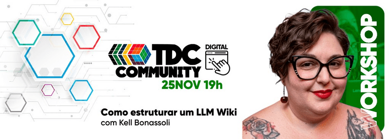

# wiki-seed

Seed para o workshop **Como estruturar um LLM Wiki**  
com Kellen Carolline Bonassoli  
25 de novembro às 19h · TDC Community

<p align="center">
  
</p>

<p align="center">
  <a href="https://github.com/eusouakell/wiki-seed/generate"></a>
  <a href="onboarding.md"></a>
  <a href="ROADMAP.md"></a>
</p>

Como organizar o conhecimento para que pessoas e agentes de IA possam acessá-lo de forma eficiente e consistente? Neste workshop exploramos o padrão **OKF** (Open Knowledge Format) e como utilizá-lo para construir uma **LLM Wiki**: uma base de conhecimento estruturada, persistente e acessível tanto por pessoas quanto por agentes.

A abordagem substitui buscas dinâmicas baseadas em vetores (como as do RAG tradicional) por uma estrutura de conhecimento organizada, reutilizável e continuamente evolutiva.

<p align="center">
  
</p>

## O que é

Um repositório semente para construir uma LLM Wiki.  
O conhecimento compilado fica em `concepts/`. O site em `site/` é apenas uma superfície para testar se o contexto está utilizável.

O harness já vem pronto.

## Como funciona

1. Crie o seu repositório com **Use this template** e clone-o
2. Leia e responda o `onboarding.md` (apresentação, instalação, personalização e guia de tarefas)
3. Coloque fontes em `raw/` (PDF do LinkedIn + texto curto)
4. Use a skill de ingestão para gerar páginas em `concepts/`
5. O agente usa progressive disclosure: lê o índice global, depois o índice do contexto, e só abre o necessário
6. A skill `skills/site/` preenche o site de exemplo a partir da wiki (teste)

## Estrutura

```
raw/                 ← fontes imutáveis (com exemplo para o exercício de ingestão)
concepts/
  index.md           ← nível 0: catálogo global (lê primeiro)
  log.md             ← histórico parseável
  overview.md        ← síntese de alto nível
  biblioteca-prisma/ ← contexto de exemplo (bounded context)
    index.md         ← nível 1: índice do contexto
    linguagem-ubiqua.md ← termos que só valem ali
    *.md             ← páginas com frontmatter OKF
skills/
  ingest/            ← raw → concepts
  query/             ← responde a partir da wiki
  lint/              ← verifica saúde e conformidade
  cleanup/           ← consolida memória e limpa
  fechar-sessao/     ← confere, guarda o que vale e registra
  site/              ← preenche o site de exemplo a partir da wiki
templates/           ← modelos de página e guia do cabeçalho (o `.okf/` das referências)
deterministic/       ← limites e orçamentos
AGENTS.md            ← schema do agente
onboarding.md        ← apresentação + guia completo
COMPARATIVO.md       ← RAG tradicional vs LLM Wiki + OKF
site/                ← superfície de teste
```

## Atributos

- **Wiki viva**: `concepts/` com catálogo global, overview e log
- **Contextos delimitados (DDD)**: cada contexto tem índice e linguagem ubíqua próprios
- **Fronteira clara**: `raw/` é imutável; `deterministic/` e `AGENTS.md` controlam o agente
- **OKF**: `type` obrigatório + title, description, tags recomendados
- **Progressive disclosure**: agente lê o índice global, depois o do contexto, e abre só o necessário
- **Seis operações**: ingest, query, lint, cleanup, site e fechar sessão
- **Site como teste**: template que mostra se o contexto funciona
- **Mensurável**: log com formato parseável

## Funcionalidades

- Onboarding completo (apresentação, instalação, personalização e guia de tarefas)
- Skills de ingestão, query, lint, cleanup, site e fechar sessão
- Modelos de página (conceito, pessoa, projeto, decisão) e guia do cabeçalho
- Onboarding que pergunta o seu ambiente (agente, acesso, objetivo) para adaptar o uso
- Site estático pronto para Pages (superfície de teste)
- Glossário e princípios separados
- Roadmap de evolução

## O que se aprende

- Como manter uma wiki que o agente ajuda a construir
- A diferença entre fonte (`raw/`) e conhecimento compilado (`concepts/`)
- Por que o agente precisa de limites claros e progressive disclosure
- Como contextos delimitados (DDD) impedem que regras de um domínio vazem para outro
- Como o formato OKF deixa o conhecimento legível por pessoas e agentes
- Hábitos de medição, limpeza e manutenção desde o início

## Trilha prática (90 min)

Os três exercícios do workshop, um por momento da aula. Todos rodam dentro da pasta do repositório, com o agente de sua preferência.

### Exercício 1 — Navegação JIT

Peça ao agente uma resposta pontual (ex.: "o que já existe na wiki sobre a Biblioteca Prisma?"). Observe que ele lê primeiro `concepts/index.md` (nível 0), abre o índice do contexto (nível 1) e só então as páginas necessárias. É o progressive disclosure na prática. Skill: `skills/query/`.

### Exercício 2 — Ingestão e compounding

A pasta `raw/` traz uma fonte bruta de exemplo: `nota-reuniao-raw.md`, com decisões desencontradas de uma reunião. Peça ao agente para rodar a skill de ingestão sobre ela. Ele deve criar ou atualizar páginas em `concepts/` e registrar a operação no `log.md` e no `index.md` — em vez de empilhar o texto bruto na wiki. Skill: `skills/ingest/`.

### Exercício 3 — LLM Lint

A página `concepts/biblioteca-prisma/lab-lint.md` contém erros de propósito. Peça ao agente para rodar a skill de lint, listar os problemas e propor correções. Skill: `skills/lint/`.

Material de apoio: `PRINCIPLES.md` (regras editoriais e de harness), `templates/` (modelos de página e guia do cabeçalho), `GLOSSARY.md` (glossário transversal; cada contexto tem seu `linguagem-ubiqua.md`) e `COMPARATIVO.md` (RAG tradicional vs LLM Wiki + OKF).

## Exemplo do resultado

A wiki começa com exemplo e overview.  
Depois da ingestão, `concepts/` tem páginas, `index.md` e `log.md` atualizados.  
O site atual mostra o exemplo fictício do ensaio (Joana Teste), preenchido a partir da wiki.

Veja o mockup em `site/index.html`.

## Para continuar depois

O `ROADMAP.md` mostra os próximos passos. `CONTEXTO-PESSOAL-A-ENTERPRISE.md` explica o que muda quando o contexto sai do uso pessoal.

## Créditos

Ideias adaptadas de outros kits abertos, com atribuição em [`CREDITOS.md`](CREDITOS.md).
